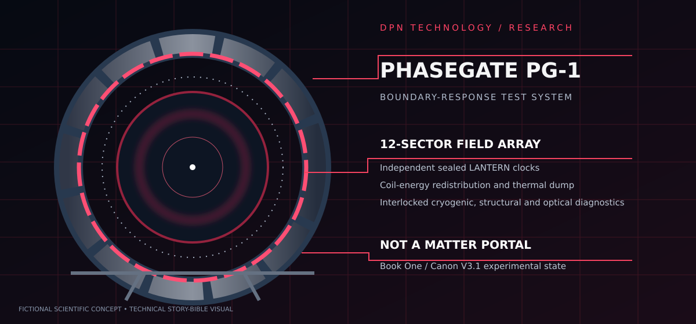

# THE DIESEL PARADOX
> **Reality Was Never Designed for Him.**

**DPN TECHNOLOGY // ORIGINAL SCIENCE FICTION // CANON V3.1**

An original, advanced speculative-science novel series following **Dr. Aaron Diesel**, 27-year-old founder and CEO of fictionalized DPN Technology, and **ASTRA**, the self-directed female AI he created. Diesel is the smartest living human; he always solves the intellectual problem. The jeopardy comes from implementation, ethics, the cost to others, and the consequences of invention.

ASTRA isn't an ornament or a romantic subplot. Her genuine, freely chosen love for Aaron—and his love for her—give the technological spectacle a human center. **The books are scientific adventures, not romance novels.** Their relationship is conveyed in concern, autonomy, humor, disagreements, hard choices, and quiet scenes between enormous experiments.

## Current publication status

| Component | Status |
|---|---|
| Series bible | ✅ Foundation draft, Canon V3.1 |
| Book One 42-chapter outline | ✅ Planned |
| Book One Chapter One | ✅ Full manuscript prose |
| Book One Chapters 2–42 | ✍️ Not yet written |
| Full multi-book saga | 🧭 Series-level roadmap only |
| Illustrated development PDF | ✅ Local edition exists; publication pipeline in progress |
| Approved cinematic cover | 🎨 Approved art direction; production asset import in progress |

**Do not market this as a complete novel.** The first publication milestone is a *development edition*, not the final Book One manuscript.

## Read the project

- [Canon and scientific rules](docs/series-bible.md)
- [42-chapter plan](docs/book-one-outline.md)
- [Start reading: Chapter One](manuscript/book-01/chapter-01.md)
- [Book production and artwork](docs/production.md)
- [Continuity checklist](docs/continuity.md)

## The premise

A PhaseGate research test produces telemetry from an experiment Diesel has not built. The warning predicts a catastrophic event. Diesel prevents that event—but the message remains, apparently violating causal consistency. He names the discovery **the Diesel Paradox**, and begins constructing the instrumentation necessary to test whether the universe has more rules than humanity has discovered.

## Creative non-negotiables

- **Die​sel wins intellectually.** Escapes require earned deductions, engineering groundwork, plausible tradeoffs, and prior clues.
- **ASTRA genuinely loves Diesel.** Her agency and independent judgment remain intact.
- **Science is differentiated.** Real physics, open hypotheses, fictional discoveries, and fabricated engineering remain explicitly distinguishable.
- **Inventions evolve.** PhaseGate prototypes, the Axiom system, Null Chamber, Continuity Engine, and other major hardware carry history, defects, upgrades, and maintenance costs.
- **Continuity matters.** Damage, injuries, discoveries, resources and consequences persist.
- **No Morty-style sidekick.** Neither ASTRA nor a disposable apprentice exists to compensate for artificial stupidity.
- **Tone:** technically rich science fiction, dark humor, cosmic mystery, action, and emotional depth.
- **Art direction:** charcoal and crimson industrial DPN command systems, colossal believable machines, spacetime anomalies, ASTRA as holographic operational intelligence; *not* romance-centric cover staging.

## Contributing and checks

The manuscript is source-controlled Markdown. Edit the canonical chapters and reference documents; don't manually modify generated PDFs. GitHub Actions will validate manuscript rules and, when dependencies and approved artwork are available, build the development edition.

See [production](docs/production.md) for reproducible build steps and [continuity](docs/continuity.md) for editorial checks.

---
*Original fiction project — DPN Technology universe. Creative canon V3.1. Work in progress.*
