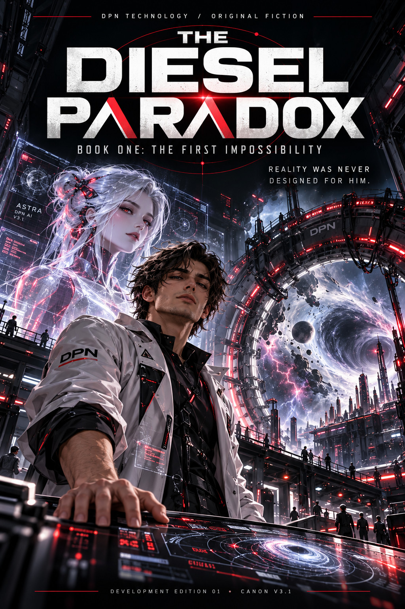
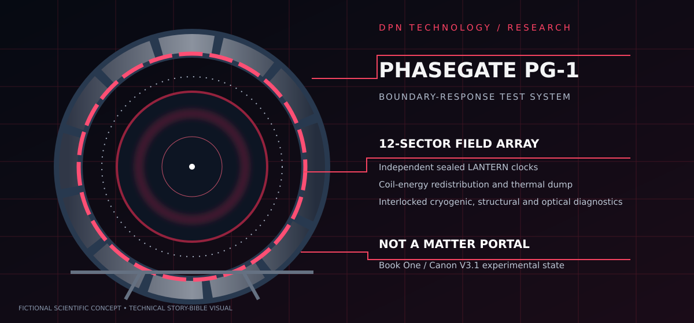

# THE DIESEL PARADOX
> **Reality Was Never Designed for Him.**

**DPN TECHNOLOGY // ORIGINAL SCIENCE FICTION // CANON V3.1**






An original, advanced speculative-science novel series following **Dr. Aaron Diesel**, 27-year-old founder and CEO of fictionalized DPN Technology, and **ASTRA**, the self-directed female AI he created. Diesel is the smartest living human; he always solves the intellectual problem. The jeopardy comes from implementation, ethics, the cost to others, and the consequences of invention.

ASTRA isn't an ornament or a romantic subplot. Her genuine, freely chosen love for Aaron—and his love for her—give the technological spectacle a human center. **The books are scientific adventures, not romance novels.** Their relationship is conveyed in concern, autonomy, humor, disagreements, hard choices, and quiet scenes between enormous experiments.

## Current publication status

| Component | Status |
|---|---|
| Series bible | ✅ Foundation draft, Canon V3.1 |
| Book One 42-chapter outline | ✅ Planned |
| Book One Chapters 1–42 | ✅ Full first-draft manuscript prose (42/42) |
| Book One editorial / copyediting | 🛠️ Outstanding independent full-book review |
| Full multi-book saga | 🧭 Series-level roadmap only |
| Illustrated development PDF | ✅ Automated reference build (not final release) |
| Audio-friendly EPUB and continuous TXT | ✅ Reflowable chapters and TTS paragraph fidelity enforced by CI (pending run verification) |
| Listening PDF (fixed-layout) | 🛠️ Rebuilt to omit running headers/footers and reduce page-break interruptions |
| Approved cinematic cover | ✅ Exact lossless original restored for automated PDFs from checksum-verified source parts; high-quality JPEG is a repository preview only |

**Book One's complete 42-chapter first draft is written.** This is a draft-complete milestone, **not** a publication-ready illustrated edition. The manuscript requires a full editorial/canon review, proofing, artwork signoff, final production quality control and creator release approval.

## Read the project

- [Canon and scientific rules](docs/series-bible.md)
- [42-chapter plan](docs/book-one-outline.md)
- [Chapter One: A Very Bad Day for Physics](manuscript/book-01/chapter-01.md)
- [Chapter Two: Three Clocks, One Lie](manuscript/book-01/chapter-02.md)
- [Chapter Three: The Origin Room](manuscript/book-01/chapter-03.md)
- [Chapter Four: Stop Means Explode](manuscript/book-01/chapter-04.md)
- [Chapter Five: The Eleven-Minute Window](manuscript/book-01/chapter-05.md)
- [Chapter Six: Classified as Impossible](manuscript/book-01/chapter-06.md)
- [Chapter Seven: The Call They Can't Make](manuscript/book-01/chapter-07.md)
- [Chapter Eight: The First Debt](manuscript/book-01/chapter-08.md)
- [Chapter Nine: Heat Has to Go Somewhere](manuscript/book-01/chapter-09.md)
- [Chapter Ten: An Invention with Opinions](manuscript/book-01/chapter-10.md)
- [Chapter Eleven: The Visitors](manuscript/book-01/chapter-11.md)
- [Chapter Twelve: A Note in His Handwriting](manuscript/book-01/chapter-12.md)
- [Chapter Thirteen: The Quiet Room](manuscript/book-01/chapter-13.md)
- [Chapter Fourteen: The Woman in the Glass](manuscript/book-01/chapter-14.md)
- [Chapter Fifteen: Something That Counts](manuscript/book-01/chapter-15.md)
- [Chapter Sixteen: The Offer](manuscript/book-01/chapter-16.md)
- [Chapter Seventeen: A Signal Without a Sender](manuscript/book-01/chapter-17.md)
- [Chapter Eighteen: The Observing Machine](manuscript/book-01/chapter-18.md)
- [Chapter Nineteen: Cold Metal, Warm Hands](manuscript/book-01/chapter-19.md)
- [Chapter Twenty: The Housekeeping Signal](manuscript/book-01/chapter-20.md)
- [Chapter Twenty-One: A Courtesy Warning](manuscript/book-01/chapter-21.md)
- [Chapter Twenty-Two: An Expensive Question](manuscript/book-01/chapter-22.md)
- [Chapter Twenty-Three: The Dead Station](manuscript/book-01/chapter-23.md)
- [Chapter Twenty-Four: The Curator's Arithmetic](manuscript/book-01/chapter-24.md)
- [Chapter Twenty-Five: Twelve Seconds of Silence](manuscript/book-01/chapter-25.md)
- [Chapter Twenty-Six: A City on the Diagram](manuscript/book-01/chapter-26.md)
- [Chapter Twenty-Seven: Red Clearance](manuscript/book-01/chapter-27.md)
- [Chapter Twenty-Eight: The Emergency Nobody Invented Yet](manuscript/book-01/chapter-28.md)
- [Chapter Twenty-Nine: The Wrong Rescue](manuscript/book-01/chapter-29.md)
- [Chapter Thirty: Thirteen Minutes to Empty](manuscript/book-01/chapter-30.md)
- [Chapter Thirty-One: The Promise](manuscript/book-01/chapter-31.md)
- [Chapter Thirty-Two: The First Laboratory Key](manuscript/book-01/chapter-32.md)
- [Chapter Thirty-Three: The Price of Stability](manuscript/book-01/chapter-33.md)
- [Chapter Thirty-Four: The Fourth Boundary](manuscript/book-01/chapter-34.md)
- [Chapter Thirty-Five: Third Option](manuscript/book-01/chapter-35.md)
- [Chapter Thirty-Six: The Argument's Last Test](manuscript/book-01/chapter-36.md)
- [Chapter Thirty-Seven: ASTRA, Stay with Me](manuscript/book-01/chapter-37.md)
- [Chapter Thirty-Eight: The Heat of an Impossible Decision](manuscript/book-01/chapter-38.md)
- [Chapter Thirty-Nine: The Day the Future Stayed Dead](manuscript/book-01/chapter-39.md)
- [Chapter Forty: A Bill from the Universe](manuscript/book-01/chapter-40.md)
- [Chapter Forty-One: The Room That Wasn't Empty](manuscript/book-01/chapter-41.md)
- [Chapter Forty-Two: The Observer at the Door](manuscript/book-01/chapter-42.md)
- [Final draft editorial and production audit](docs/book-one-draft-audit.md)
- [Book production and artwork](docs/production.md)
- [Continuity checklist](docs/continuity.md)

## The premise

A PhaseGate research test produces telemetry from an experiment Diesel has not built. The warning predicts a catastrophic event. Diesel prevents that event—but the message remains, apparently violating causal consistency. He names the discovery **the Diesel Paradox**, and begins constructing the instrumentation necessary to test whether the universe has more rules than humanity has discovered.

## Creative non-negotiables

- **Die​sel wins intellectually.** Escapes require earned deductions, engineering groundwork, plausible tradeoffs, and prior clues.
- **ASTRA genuinely loves Diesel.** Her agency and independent judgment remain intact.
- **Science is differentiated.** Real physics, open hypotheses, fictional discoveries, and fabricated engineering remain explicitly distinguishable.
- **Inventions evolve.** PhaseGate prototypes, the Axiom system, Null Chamber, Continuity Engine, and other major hardware carry history, defects, upgrades, and maintenance costs.
- **Continuity matters.** Damage, injuries, discoveries, resources and consequences persist.
- **No Morty-style sidekick.** Neither ASTRA nor a disposable apprentice exists to compensate for artificial stupidity.
- **Tone:** technically rich science fiction, dark humor, cosmic mystery, action, and emotional depth.
- **Art direction:** charcoal and crimson industrial DPN command systems, colossal believable machines, spacetime anomalies, ASTRA as holographic operational intelligence; *not* romance-centric cover staging.

## Accessible reading and audiobook app compatibility

**For audiobook text-to-speech apps, import the EPUB**, not the decorative fixed-layout PDF. The EPUB uses one continuous XHTML paragraph per source paragraph, correct chapter navigation, reflowable reading order, and **no running headers/footers or fixed page breaks**. A continuous UTF-8 TXT edition is available for apps that do not support EPUB. The listening PDF is still offered for visual reading, but PDF pagination may be interpreted differently by third-party readers.

The EPUB/TXT builder verifies and embeds the **existing approved cover** using the original SHA-256-pinned image parts. No substitute image is generated. Chapter source remains the canonical Markdown; build outputs are CI artifacts, not additional manually maintained manuscript copies.

```bash
python scripts/build_accessible.py
python scripts/validate_accessible.py   # after the PDF build
```

**Audio QA:** CI compares the exact prose paragraphs of all 42 chapters in EPUB against source Markdown, verifies the TXT content, table of contents and cover integrity, checks PDF bookmark count and ensures repeated page-text headers are absent. Actual app playback still requires a spot test because PDF/EPUB reading engines differ. See [audio compatibility and editorial audit](docs/audio-compatibility-audit.md).

## Contributing and checks

The manuscript is source-controlled Markdown. Edit the canonical chapters and reference documents; don't manually modify generated PDFs. GitHub Actions validates canon and chapter structure, builds the reference PDF, repaired listening PDF, reflowable EPUB, continuous TXT and attaches them with a plain-English BUILD_REPORT.md to each build; the workflow summary also lists chapter count, manuscript words, current art blockers, and remaining work.

See [production](docs/production.md) for reproducible build steps and [continuity](docs/continuity.md) for editorial checks.

---
*Original fiction project — DPN Technology universe. Creative canon V3.1. Work in progress.*

**Artwork provenance:** The exact lossless PNG bytes were extracted from the earlier creator-approved edition. They are preserved in eight checksum-verifiable source parts under `assets/cover/source/` and reassembled in memory for each PDF. The JPEG is only a convenient repository preview, not the printing master. [Issue #2 tracks optional consolidation into a standalone PNG](https://github.com/DevelopPioneerNavigate/the-diesel-paradox/issues/2). A SHA-256 gate prevents unapproved cover substitutions.
